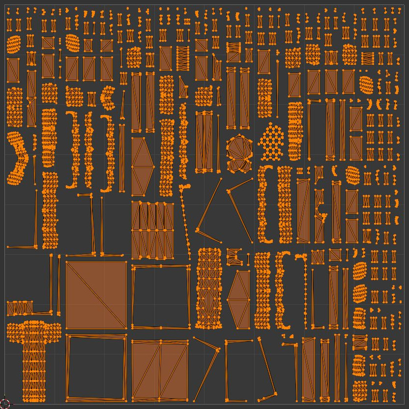
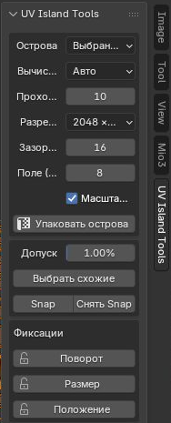

# UV Island Tools

Расширение Blender для плотной упаковки UV-островов. Оно сравнивает несколько вариантов размещения в тайле 0–1, учитывает форму островов и соблюдает заданные отступы в пикселях.

**[Скачать UV Island Tools 1.3.0 (ZIP)](https://raw.githubusercontent.com/Rorosos/UV-island-pack-tools-/main/downloads/uv_island_tools-1.3.0.zip)**

## Пример на модели Hive

UV-развёртки двух копий модели показаны в одинаковом масштабе.

| Blender Smart UV Project | UV Island Tools |
| --- | --- |
|  |  |

## Установка

1. Скачайте ZIP по ссылке выше. Архив можно установить целиком.
2. В Blender откройте **Edit → Preferences → Get Extensions**.
3. В меню со стрелкой в правом верхнем углу выберите **Install from Disk…** и укажите файл `uv_island_tools-1.3.0.zip`.

## Как пользоваться

1. Откройте меш с UV-развёрткой в **Edit Mode**. В **UV Editor** нажмите `N` и откройте вкладку **UV Island Tools**.
2. Выделите острова, задайте разрешение текстуры, зазор между островами и поле от края тайла.
3. Нажмите **Упаковать острова**. По умолчанию расширение проверяет **100 проходов** с разными позициями, углами и порядком размещения. `Esc` отменяет поиск, `Ctrl+Z` отменяет применённую упаковку.

- **Выбрать схожие** находит острова с близким UV-контуром по заданному допуску.
- **Snap** совмещает схожие острова, включая острова с дополнительными вершинами на том же контуре. При следующих упаковках группа перемещается вместе. Кнопка **Снять Snap** разъединяет группу.
- **Поворот**, **Размер** и **Положение** независимо фиксируют угол, масштаб или центр острова.

### Отступы и разрешение

| Пресет | Зазор между островами | Поле от края тайла |
| --- | ---: | ---: |
| 512 × 512 | 4 px | 2 px |
| 1024 × 1024 | 8 px | 4 px |
| 2048 × 2048 | 16 px | 8 px |
| 4096 × 4096 | 32 px | 16 px |
| 8192 × 8192 | 64 px | 32 px |

Отступы можно менять независимо. Для прямоугольных текстур выберите **Своё разрешение** и задайте ширину и высоту. Число проходов можно настроить от 1 до 1000. При включённом масштабировании расширение выбирает допустимый вариант с наибольшим общим масштабом среди проверенных.

## Требования

- **Blender 5.3.0 или новее.** Сборка проверена на Blender 5.3.0 под Windows x64.
- **CPU.** Расширение включает нативный модуль для Windows x64 и резервный расчёт на Python.
- **GPU.** Доступны вычислительный шейдер Blender через OpenGL или Vulkan, гибридный режим CPU + GPU и CUDA для совместимых видеокарт и драйверов NVIDIA. CUDA-модуль входит в ZIP. Режим **Авто** выбирает подходящий вариант.

## Исходники и обратная связь

Код, `__init__.py` и команды пересборки находятся в [каталоге расширения](uv_island_tools/). О проблемах и предложениях можно сообщить в [Issues](https://github.com/Rorosos/UV-island-pack-tools-/issues).

Лицензия [GNU GPL-3.0-or-later](LICENSE).
