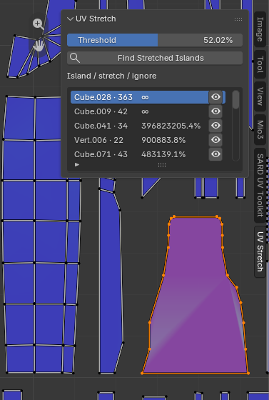
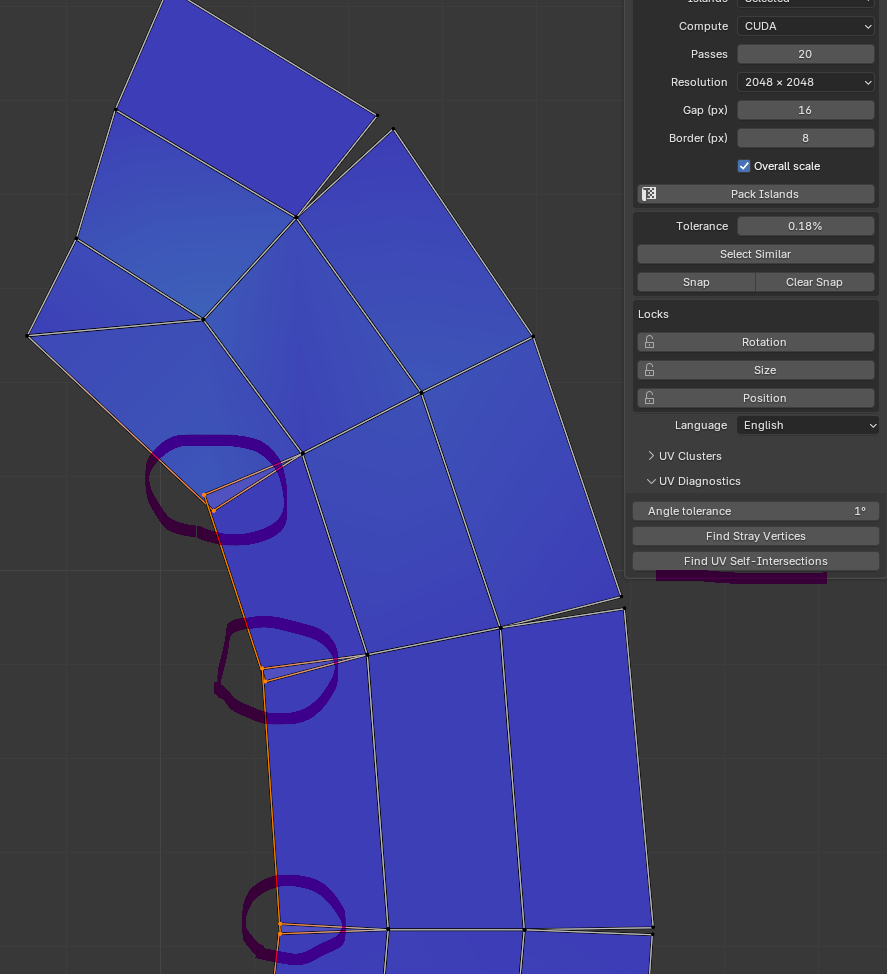
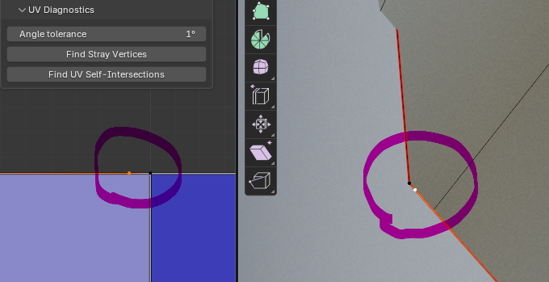
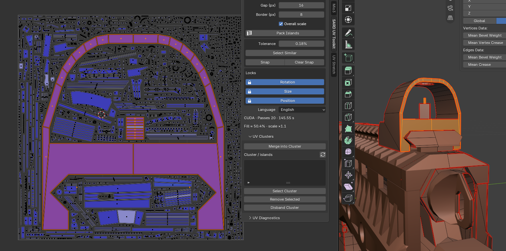
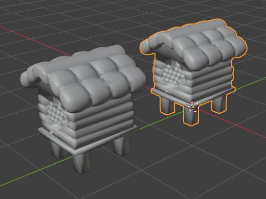

# SARD UV Toolkit

A Blender extension for dense UV packing, island diagnostics, and UV cluster management.

AI-assisted coding

**[Download SARD UV Toolkit 1.5.0 (ZIP)](https://raw.githubusercontent.com/Rorosos/SARD_UV_Toolkit/main/downloads/sard_uv_toolkit-1.5.0.zip)**

## Installation

1. Download the ZIP.
2. In Blender, open **Edit → Preferences → Get Extensions**.
3. Open the menu in the upper-right corner, choose **Install from Disk…**, and select the ZIP.
4. Open a mesh with a UV map in **Edit Mode**. Press `N` in the **UV Editor** and open **SARD UV Toolkit**.

Use the language selector in the sidebar or the extension preferences. Available languages are English, Simplified Chinese, Hindi, Spanish, Arabic, French, Armenian, Brazilian Portuguese, and Russian.

## UV diagnostics

### Detect and select subtle UV distortion

In **UV Stretch**, set a threshold to find islands with directional distortion that can be difficult to see in the UV Editor. The results table lists visible islands at or above the threshold and selects them for inspection. Use the eye button to keep an island in the report while excluding it from automatic selection. The ignore flag is saved per UV map.

The reported percentage reflects the largest directional scale difference on any triangle in the island, accounting for the texture aspect ratio. A collapsed UV triangle can report `∞`.

### Select self-intersecting UV islands

**Find UV Self-Intersections** selects islands with crossed polygon edges or overlapping UV faces within the same island. The selected UVs make it easier to locate folds and inspect the affected geometry.

### Find redundant vertices on N-gon edges

**Find Stray Vertices** selects vertices along straight N-gon edges where exactly two mesh edges meet. Use **Angle tolerance** to include near-collinear vertices. Inspect the selection in the UV Editor or 3D viewport before editing the mesh.

## Packing, Snap, and clusters

- **Pack Islands** evaluates different positions, angles, and island orders. It defaults to 100 passes and supports 1–1000. If the current placement is unsuitable, the packer tries randomized starts while honoring locks and padding. Press `Esc` to stop the search or `Ctrl+Z` to undo an applied layout.
- **Select Similar** compares the number, positions, and connections of UV vertices, including those inside the outline. **Snap** aligns matching vertices to the reference and keeps the islands stacked during packing.
- **Merge into Cluster** creates a cluster, adds islands, or merges selected clusters. The **UV Clusters** table lets you select or disband a cluster. **Remove Selected** takes specific islands out of it. Packing transforms the cluster as a unit, preserving the relative placement of its members. Apply Snap before clustering if you want islands to overlap exactly.

### Preserve island rotation, size, and position

Enable **Rotation**, **Size**, and **Position** independently to protect an island's orientation, dimensions, or placement during packing. A member's locks constrain its cluster. The same panel provides controls for texture resolution, pixel padding, search passes, compute backend, and overall scaling.

Unlocked island sizes are normalized by 3D surface area. Enable **Overall scale** to let the packer adjust the shared scale for better tile usage.

### Texture sizes and padding

| Preset | Gap between islands | Border |
| --- | ---: | ---: |
| 512 × 512 | 4 px | 2 px |
| 1024 × 1024 | 8 px | 4 px |
| 2048 × 2048 | 16 px | 8 px |
| 4096 × 4096 | 32 px | 16 px |
| 8192 × 8192 | 64 px | 32 px |

Both margins are editable in pixels. Choose **Custom resolution** for rectangular textures.

## Hive packing example

The UV layouts use the same view scale. The toolkit capture is from version 1.3.0, when the extension was called UV Island Tools.

| Blender Smart UV Project | Toolkit packing (1.3.0) |
| --- | --- |
|  |  |

## Requirements

- **Blender 5.3.0 or newer.** Version 1.5.0 was tested with Blender 5.3.0 on Windows x64.
- **CPU.** A native Windows x64 module is included, with a Python fallback.
- **GPU.** Blender compute shaders support OpenGL or Vulkan. CPU + GPU hybrid mode and direct CUDA are also available. CUDA requires a compatible NVIDIA GPU and driver.

## Source and feedback

See the [extension source and build instructions](uv_island_tools/) or [open an issue](https://github.com/Rorosos/SARD_UV_Toolkit/issues).

[GNU GPL-3.0-or-later](LICENSE)
